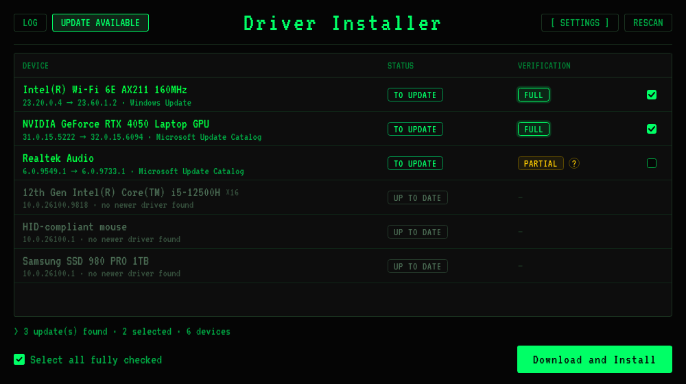
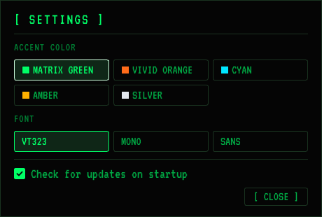

# driver-installer (SafeDriver)

Open-source driver and firmware updater for Windows and Linux. No ads, no
telemetry, no background service. Working prototype: real installation behind
a dry-run default.

```
pip install cryptography PySide6 pytest
python -m pytest -q                                  # 457 tests, no admin rights or internet needed

python src/cli.py scan                               # hardware vs. manifest (table, or --json)
python src/cli.py check --notify                     # exit 0 up to date, 1 updates, 2+ error
python src/cli.py update --all                       # download, verify, print the plan (dry run)
python src/cli.py update --all --apply -y            # unattended install
python src/cli.py gui --demo                         # GUI with fake packages; never installs
QT_QPA_PLATFORM=offscreen python tools/screenshots.py   # re-render docs/img/ui-main.png and ui-settings.png
```



The window has one design, a Matrix-style terminal: sharp 1 px borders, capitals and brackets on
the controls. **[ SETTINGS ]** in the header picks the accent colour (Matrix Green, Vivid Orange,
Cyan, Amber, Silver), the font (VT323, Mono, Sans) and whether to check for a newer release on
startup; every change applies at once and is remembered in `ui.json`
(`~/.config/driver-installer/` or `%APPDATA%\driver-installer\`). Full / Partial / None keep
their green / amber / red whatever the accent.



Identical devices are shown once: Windows lists every logical CPU as its own device, so a
16-thread CPU is one row marked `×16` (`x16` in `scan`). The merged entry keeps all 16 instance
IDs, so update matching and the install still cover each of them. Devices are merged only when
name, model ID, driver package and installed version all match.

The update check (on by default, off in Settings) asks
`api.github.com/repos/Codeee-man/driver-installer/releases/latest` once per start, in the
background, with a 3 s timeout. It sends nothing but the program name and version; offline or
rate-limited, it stays silent. When a newer release exists, an **UPDATE AVAILABLE** button
appears in the header and opens the release page; nothing is downloaded by itself.

Without a manifest the tool discovers updates itself: on Windows, Windows Update (the drivers
Windows offers this PC) plus the Microsoft Update Catalog searched by hardware ID (hardware IDs
are sent to Microsoft; `--no-discover` turns it off); on Linux, fwupd/LVFS and the distro's
driver tool. `--debug` (or LOG in the window) shows every step: devices scanned, queries,
results, and why each result was skipped. Every Windows driver package is checked against the
LOLDrivers list of known vulnerable drivers before install.

Releases: push a tag `vMAJOR.MINOR.PATCH` (the current line is `v1.1.x`; the next is `v1.1.4`; describe it under Unreleased in `CHANGELOG.md` first) and
`.github/workflows/build.yml` tests on Windows and Linux, installs the Windows build as a standard
user, then attaches `DriverInstaller-Setup.exe`, `DriverInstaller-Windows-Portable.zip`, a `.deb` and an
`.AppImage` (plus `SHA256SUMS`) to a published release. Build locally with
`python tools/build_linux.py all` or `py tools\build_windows.py` (the installer needs Inno Setup 6).

On Windows there is one program, `DriverInstaller.exe`: double-click it for the window; give it
arguments (`DriverInstaller.exe scan --json > scan.json`) for the CLI; it elevates itself for
installs. `DriverInstaller-Setup.exe` installs it to `C:\Program Files\Driver Installer`, locked so
only administrators can change it, with an optional `driver-installer` command on PATH. Because
the program is windowed, an interactive `cmd` prompt does not wait for it; use the
`driver-installer` command, `start /wait DriverInstaller.exe ...`, or redirect the output.
Both are Authenticode-signed when the repository has the `WINDOWS_PFX_BASE64`/`WINDOWS_PFX_PASSWORD`
secrets (see `docs/SIGNING.md`); otherwise unsigned.

Before real use:

1. Pin a signing key and sign your manifest: `tools/pin_key.sh`, see `docs/SIGNING.md`.
2. Install the protected helper: `sudo tools/install_helper.sh [--with-timer]`
   (Windows: `DriverInstaller-Setup.exe`; from a checkout, `tools\install_helper.ps1`). Without it the
   tool still works but warns, because it elevates code your user account can edit.
3. Optional weekly check: `systemctl --user enable --now driver-installer.timer`.

Windows Update drivers that the public catalog cannot serve (its download dialog answers
`302 -> ErrorInline.aspx`, common for OEM drivers) are not downloaded during the scan: Windows lets
only administrators copy them out of its cache. Their checks show as "checked by the installer"
(`»` in the `(?)`), and the installer, as administrator, has the Windows Update Agent download them,
runs LOLDrivers on every `.sys` and requires a valid signature on every catalog before `pnputil`
runs, refusing the update otherwise. While it works, the status line and LOG follow it live
(`[admin]` lines). Every failed check shows its real reason in the `(?)` next to the badge and in LOG.

Layout:

```
src/
  cli.py, ui/                 front ends (never elevated); demo.py (gui --demo)
  windows_main.py             DriverInstaller.exe: GUI, CLI and --apply-plan helper in one program
  helper_main.py              the elevated helper (--apply-plan <plan.json> only)
  core/
    engine.py                 scan -> discover -> download + verify -> plan -> helper
    scanner_win.py, scanner_linux.py   hardware inventory (WMI, lspci/lsusb, fwupd)
    discovery/                Windows Update Agent, Microsoft Update Catalog, LVFS/distro tools
    verifier.py               HTTPS fetches, SHA-256 gated downloads, Authenticode, GPG
    security/loldrivers.py    LOLDrivers (BYOVD) blocklist
    installer.py              unpack, pnputil / fwupd / package manager
    elevation.py              which helper to elevate, UAC / pkexec / sudo
    restore.py, manifest.py, trust.py, model.py, common.py, diagnostics.py
    updates.py                startup check for a newer release (GitHub API, 3 s, silent on errors)
  ui/                         the window: theme.py (accent + font presets), settings.py (ui.json),
                              settings_dialog.py ([ SETTINGS ]), models.py, delegates.py, main_window.py
packaging/windows/            PyInstaller spec, Inno Setup script (DriverInstaller-Setup.exe)
tools/
  build_windows.py, build_linux.py, build_common.py   release builds (zip + Setup.exe, .deb + AppImage)
  codesign_windows.py         Authenticode signing with signtool (docs/SIGNING.md)
  diagnose_windows.ps1        why Windows refuses to start the program (read-only)
  install_helper.sh|.ps1      protected helper from a source checkout
  pin_key.sh, keygen.py       create and pin a manifest signing key
  build_manifest.py, sign_manifest.py   manifest from a driver folder; sign a manifest
  changelog.py                CHANGELOG.md section for a release's notes
  screenshots.py              headless README screenshots (main window, Settings)
schema/                       manifest schema 1.1 and an example
contrib/                      systemd user units, polkit policy, desktop file, icons
docs/                         ARCHITECTURE.md, SIGNING.md, TESTING_WINDOWS.md, img/
tests/                        pytest suite with recorded WMI fixtures and loopback HTTP servers
.github/workflows/            ci.yml (tests on push), build.yml (release builds on v* tags)
```

The default font is the bundled VT323 (SIL Open Font License, `src/ui/assets/fonts/VT323-OFL.txt`).
